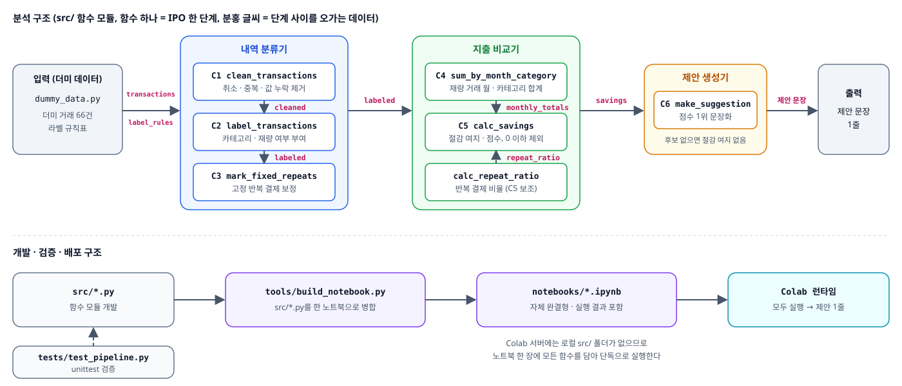

# 카드 지출 절감 제안기

최근 3개월 카드 내역을 비교해, **이번 달 줄일 재량 지출 1개**와 **절감 여지 금액**을
과거 실적 근거와 함께 한 문장으로 알려 준다.

```
[제안] 카페·간식: 이번 달 187,000원, 최근 3개월 최저 120,000원(2026-07) → 절감 여지 67,000원, 반복 결제 62%
```

> 알고리즘과 컴퓨터적 사고 · Project 2 (Group 03). 입력은 전부 **더미 데이터**(손으로 만든 가상 거래 내역)이며 실제 카드 CSV를 읽지 않는다.

## 프로젝트 개요

| 항목 | 내용 |
|---|---|
| 문제 | 카드값은 많이 나오는데 어디서 새는지 모른다. 매일 기록하는 가계부는 이미 포기했다 |
| 사용자 | 월 1회 몰아서 확인하고 싶은 20대 대학생 |
| 목표 | 한 달에 한 번, 줄일 곳 하나와 그 근거를 한 줄로 받는다 |
| 제약 | 표준 문법만 사용 (List · Dict · if · for · 함수). 외부 라이브러리, 머신러닝, 실시간 연동 없음 |
| 산출물 | Colab 노트북 1개. "모두 실행"하면 제안 문장 1줄이 출력된다 |

## 핵심

**1. 줄일 수 있는 돈만 본다.** 거래를 재량(식비 · 카페·간식 · 쇼핑)과 고정(교통 · 구독료 · 기타)으로 나누고,
재량 지출만 비교한다. 3개월 내내 같은 날·같은 금액으로 월 1건 빠지는 결제(예: 멤버십)는 고정으로 바꾼다.

**2. 과거의 나와 비교한다.** 카테고리마다 이번 달 지출에서 최근 3개월 중 가장 적게 쓴 달의 지출을 뺀 값이
절감 여지다. 이번 달이 가장 적었다면 줄일 근거가 없으므로 후보에서 뺀다.

**3. 줄이기 쉬운 것을 먼저 고른다.** 점수가 가장 높은 카테고리 1개만 제안한다.

```
점수 = 0.6 × 절감 여지 비율 + 0.4 × 반복 결제 비율
절감 여지 비율 = (이번 달 − 3개월 최저) ÷ 이번 달
반복 결제 비율 = 2번 이상 간 가맹점의 결제 건수 ÷ 전체 결제 건수
```

같은 곳을 반복해서 가는 습관일수록 줄이기 쉽다고 보고 가중치를 준다.

## 아키텍처



## 실행

```bash
python -m src.main                  # 제안 문장 1줄 출력
python -m unittest discover tests   # 테스트 실행
python tools/build_notebook.py      # src/*.py → 노트북 재생성
```

Colab에서는 `notebooks/card_saving_suggester.ipynb`를 열고 **런타임 → 모두 실행**. Python 3.10 이상, 설치할 라이브러리 없음.

상세 설계(스키마, 함수 명세, 테스트 케이스, 일정)는 [`docs/plan.md`](docs/plan.md)를 본다.
