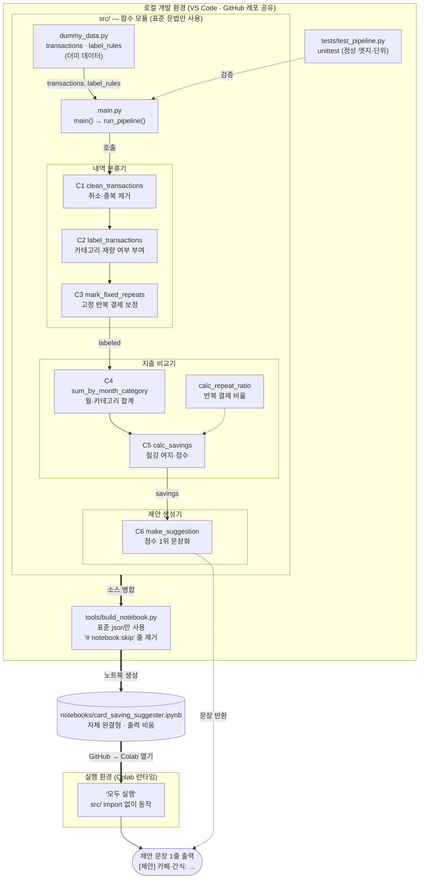

# plan.md — 카드 지출 절감 제안기 (Project 2 · Group 03)

> 이 문서는 Claude Code가 구현 작업 시 따르는 **단일 기준 문서**다.
> 근거 자료: Project 1 개인 워크시트(고준호, 1-1~1-6 · 시스템 다이어그램) + 14주차 그룹 기획서(Phase 1).
> 기획서와 이 문서가 충돌하면 **14주차 기획서가 우선**이며, 기획서에 없는 부분은 이 문서의 "8. 구현 결정 사항"을 따른다.

---

## 목차

- [1. 프로젝트 개요](#1-프로젝트-개요)
- [2. 개발 환경](#2-개발-환경)
  - [2-1. Colab 연결 시 주의사항 (중요)](#2-1-colab-연결-시-주의사항-중요)
- [3. 레포 구조](#3-레포-구조)
  - [3-1. 모듈 간 import 규칙](#3-1-모듈-간-import-규칙)
  - [3-2. 로컬 확인 명령](#3-2-로컬-확인-명령)
- [4. 코딩 규칙](#4-코딩-규칙)
- [5. 데이터 스키마](#5-데이터-스키마)
  - [5-1. 카테고리 (6개 고정)](#5-1-카테고리-6개-고정)
  - [5-2. 샘플 (기획서 원문)](#5-2-샘플-기획서-원문)
- [6. IPO 파이프라인](#6-ipo-파이프라인)
  - [6-1. 데이터 흐름](#6-1-데이터-흐름)
  - [6-2. 시스템 아키텍처](#6-2-시스템-아키텍처)
- [7. 함수 명세](#7-함수-명세)
  - [C1 `clean_transactions(transactions) -> list`](#c1-clean_transactionstransactions---list)
  - [C2 `label_transactions(cleaned, label_rules) -> list`](#c2-label_transactionscleaned-label_rules---list)
  - [C3 `mark_fixed_repeats(labeled) -> list`](#c3-mark_fixed_repeatslabeled---list)
  - [C4 `sum_by_month_category(labeled) -> dict`](#c4-sum_by_month_categorylabeled---dict)
  - [`calc_repeat_ratio(labeled, category, month) -> float`](#calc_repeat_ratiolabeled-category-month---float)
  - [C5 `calc_savings(monthly_totals, labeled, this_month) -> list`](#c5-calc_savingsmonthly_totals-labeled-this_month---list)
  - [C6 `make_suggestion(savings) -> str`](#c6-make_suggestionsavings---str)
  - [`main()`](#main)
- [8. 구현 결정 사항 (기획서에 명시되지 않아 이 문서에서 정한 것)](#8-구현-결정-사항-기획서에-명시되지-않아-이-문서에서-정한-것)
- [9. 더미 데이터 설계 (dummy_data.py)](#9-더미-데이터-설계-dummy_datapy)
- [10. 테스트 케이스 (tests/test_pipeline.py)](#10-테스트-케이스-teststest_pipelinepy)
- [11. Git 협업 규칙](#11-git-협업-규칙)
- [12. 역할 분담 및 일정](#12-역할-분담-및-일정)
- [13. Claude Code 작업 지침](#13-claude-code-작업-지침)
  - [구현 순서](#구현-순서)
  - [완료 기준 (Definition of Done)](#완료-기준-definition-of-done)
  - [하지 말 것](#하지-말-것)

---

## 1. 프로젝트 개요

| 항목 | 내용 |
|---|---|
| 과목 | 알고리즘과 컴퓨터적 사고 · Project 2 그룹 프로젝트 |
| 조 | Group 03 — 고준호(팀장), 정하나, 안태현 |
| 주제 | 카드 지출 절감 제안기 |
| 한 줄 정의 | 최근 3개월 카드 내역을 비교해, 이번 달 줄일 **재량 지출 1개**와 **절감 여지 금액**을 과거 실적 근거와 함께 제시한다 |
| 사용자 | 카드값이 많이 나오지만 어디서 새는지 모르는 20대 대학생 1명. 매일 기록하는 가계부는 포기했고, 월 1회 몰아서 확인하길 원함 |
| 최종 산출물 | Colab 노트북 1개 ("모두 실행" 시 제안 문장 1줄 출력) + GitHub 레포 + 3분 영상 + Miro |

---

## 2. 개발 환경

- **에디터**: VS Code + Colab 확장(노트북 커널을 Colab 런타임에 연결)
- **협업**: GitHub 레포 1개를 팀원 3명이 공유
- **Python**: Colab 기본 런타임 버전 기준 (로컬 테스트는 Python 3.10 이상)
- **라이브러리 범위** (근거: 기획서 3-6 ④, 3-1 제약 조건, 3-2 Drop)
  - 솔루션 코드(C1~C6, main): 외부 라이브러리 없이 List · Dict · if · for · 함수로만 구현. 딕셔너리 복사는 `dict(거래)`로 처리
  - 개발 도구(`tools/build_notebook.py`, `tests/`): Python 표준 라이브러리(`json`, `unittest`)만 사용. 제출 로직에는 포함하지 않음
  - 금지: pandas, numpy, scikit-learn 등 외부 라이브러리, 머신러닝, 실제 CSV 파일 읽기, 실시간 연동

### 2-1. Colab 연결 시 주의사항 (중요)
- VS Code에서 노트북 커널을 Colab에 연결하면 코드는 **Colab 서버**에서 실행된다. 로컬의 `src/` 폴더는 Colab 런타임에 없다.
- 따라서 **제출용 노트북은 자체 완결형**이어야 한다. 노트북 안에서 `from src... import` 하지 않는다.
- 해결 방식: 함수는 `src/*.py`에서 개발·테스트하고, `tools/build_notebook.py`가 이를 하나의 노트북으로 합쳐 생성한다 (아래 3장).

---

## 3. 레포 구조

```
group03-card-saving-suggester/
├── docs/
│   └── plan.md                   # 이 문서
├── README.md                     # 실행 방법, 팀원·역할 (담당: 정하나)
├── .gitignore                    # __pycache__/, .ipynb_checkpoints/, .DS_Store
├── src/
│   ├── __init__.py
│   ├── dummy_data.py             # transactions, label_rules, 테스트용 데이터셋 (고준호)
│   ├── c1_clean.py               # clean_transactions (안태현)
│   ├── c2_label.py               # label_transactions (고준호)
│   ├── c3_fixed.py               # mark_fixed_repeats (고준호)
│   ├── c4_sum.py                 # sum_by_month_category (정하나)
│   ├── c5_repeat_ratio.py        # calc_repeat_ratio (안태현)
│   ├── c5_savings.py             # calc_savings (정하나)
│   ├── c6_suggest.py             # make_suggestion (안태현)
│   └── main.py                   # main — C1~C6 연결 (정하나)
├── tests/
│   └── test_pipeline.py          # unittest 기반 테스트 케이스 (고준호·안태현)
├── tools/
│   └── build_notebook.py         # src/*.py → notebooks/ 노트북 생성 (표준 json만 사용)
└── notebooks/
    └── card_saving_suggester.ipynb   # 제출용 통합 노트북 (생성물)
```

### 3-1. 모듈 간 import 규칙
- `src` 내부 모듈끼리 import하는 줄에는 끝에 `# notebook:skip` 주석을 단다.
  ```python
  from src.c1_clean import clean_transactions  # notebook:skip
  ```
- `build_notebook.py`는 `# notebook:skip`이 붙은 줄을 제거하고 아래 순서로 셀을 만든다.
  1. 마크다운: 제목, 문제 정의, 사용자·목표·제약, 성공 기준
  2. 코드: `dummy_data.py` (셀 상단 주석과 마크다운에 **"더미 데이터"** 명시)
  3. 마크다운 + 코드: C1 → C2 → C3 → C4 → calc_repeat_ratio → C5 → C6 (각 셀 앞에 IPO 요약 마크다운, 담당자 표기)
  4. 코드: `main` 정의 + `main()` 호출
  5. 코드: 테스트 케이스 실행 셀 (정상 / 후보 0개 / 값 누락 결과 출력)
- `main.py`의 `if __name__ == "__main__":` 블록은 노트북에서 `main()` 호출 셀로 대체한다.
- 생성되는 노트북은 출력(outputs)이 비어 있는 상태로 커밋한다.

### 3-2. 로컬 확인 명령
```bash
python -m src.main                       # 제안 문장 1줄 출력
python -m unittest discover tests        # 테스트 실행
python tools/build_notebook.py           # 노트북 재생성
```

---

## 4. 코딩 규칙

- **함수명·딕셔너리 키는 기획서 표기(snake_case)를 그대로 사용**한다. 제출 문서(기획서 3-4, 3-5, 역할 분담표)와 이름이 일치해야 하므로 임의로 바꾸지 않는다. 지역 변수도 snake_case로 통일한다.
- **주석과 docstring은 한국어**로 작성한다.
- 각 함수는 입력을 직접 수정하지 않고 **새 리스트/딕셔너리를 반환**한다 (C3도 복사본을 고쳐 반환).
- 함수 하나 = 기획서의 IPO 한 단계. 함수 간 데이터는 반드시 **반환값 → 다음 함수의 인자**로만 전달한다 (전역 변수 의존 금지, 상수 제외).
- 상수는 `src/dummy_data.py` 상단 또는 각 모듈 상단에 대문자로 둔다.
  ```python
  SAVING_WEIGHT = 0.6      # 절감 여지 비율 가중치
  REPEAT_WEIGHT = 0.4      # 반복 결제 비율 가중치
  FALLBACK_CATEGORY = "기타"   # 미매칭 카테고리 (출력 표기는 "기타(고정)")
  ```
- 카테고리 문자열의 가운뎃점은 `·`(U+00B7)로 통일한다: `"카페·간식"`.

---

## 5. 데이터 스키마

| 변수 | 자료형 | 필드 | 생성 단계 |
|---|---|---|---|
| `transactions` | List of Dict | `date`(str, "YYYY-MM-DD"), `merchant`(str), `amount`(int, 원) | 더미 |
| `label_rules` | List of Dict | `keyword`(str), `category`(str, 6개 중 1), `is_discretionary`(bool) | 더미 |
| `cleaned` | List of Dict | `transactions`와 동일 | C1 출력 |
| `labeled` | List of Dict | `month`(str, "YYYY-MM"), `day`(int), `merchant`, `category`, `is_discretionary`, `amount` | C2 출력 → C3 보정 |
| `monthly_totals` | Dict of Dict | `{카테고리: {거래월: 합계}}` — **재량 카테고리만** | C4 출력 |
| `savings` | List of Dict | `category`, `this_month`, `min_month`, `min_amount`, `saving`, `saving_ratio`, `repeat_ratio`, `score` | C5 출력 |
| 제안 문장 | str | — | C6 출력 |

- `savings`의 `this_month`는 **이번 달 지출 금액(int)**, `min_month`는 최저 지출 월 문자열("2026-07")이다. `min_amount`, `saving_ratio`는 C6 문장 조립과 점수 확인을 위해 이 문서에서 추가한 필드다.
- C3는 고정으로 재분류한 거래에 `is_fixed_repeat: True` 필드를 추가해도 된다(선택. 기획서의 "고정 결제 목록 보여주기" 확장용).

### 5-1. 카테고리 (6개 고정)

| 구분 | 카테고리 |
|---|---|
| 재량 (`is_discretionary=True`) | 식비, 카페·간식, 쇼핑 |
| 고정 (`is_discretionary=False`) | 교통, 구독료, 기타 |

### 5-2. 샘플 (기획서 원문)
```python
transactions = [  # 카드 거래 내역 (더미)
    {"date": "2026-09-05", "merchant": "스타벅스 한양대점", "amount": 5600},
    {"date": "2026-09-10", "merchant": "넷플릭스", "amount": 13500},
]
label_rules = [  # 라벨 규칙표 (더미)
    {"keyword": "스타벅스", "category": "카페·간식", "is_discretionary": True},
    {"keyword": "넷플릭스", "category": "구독료", "is_discretionary": False},
]
```

---

## 6. IPO 파이프라인

### 6-1. 데이터 흐름

```
transactions ──C1──▶ cleaned ──C2(+label_rules)──▶ labeled ──C3──▶ labeled(보정)
                                                                     │
                     ┌───────────────────────────────────────────────┤
                     ▼                                               ▼
               C4 → monthly_totals ──▶ C5(+labeled, this_month) ──▶ savings ──C6──▶ 제안 문장 1줄
```

| 단계 | 함수 | Input | Process | Output |
|---|---|---|---|---|
| C1 | `clean_transactions` | transactions | 금액 0 이하(취소) 건과 완전히 같은 중복 건 제거 | cleaned |
| C2 | `label_transactions` | ↑C1 출력 + label_rules | 가맹점명에 키워드가 있으면 카테고리·재량 여부 부여, 없으면 "기타"/고정. 날짜를 월·일로 분리 | labeled |
| C3 | `mark_fixed_repeats` | ↑C2 출력 | 같은 가맹점이 3개월 내내 월 1건·같은 일·같은 금액이면 고정으로 변경 | 보정된 labeled |
| C4 | `sum_by_month_category` | ↑C3 출력 | 재량 거래만 카테고리 × 거래월 합계 | monthly_totals |
| C5 | `calc_savings` | ↑C4 출력 + ↑C3 출력 + this_month | 절감 여지 → 0 이하 제외 → 비율 → 점수 | savings |
| (C5 보조) | `calc_repeat_ratio` | labeled, category, month | 2회 이상 가맹점의 건수 ÷ 전체 건수 | float |
| C6 | `make_suggestion` | ↑C5 출력 | 점수 내림차순 1위로 문장 생성, 비면 "절감 여지 없음" | str |
| — | `main` | 없음 | C1→C6 순서 호출 후 print | 출력 |

Project 1의 3개 컴포넌트와의 대응: **내역 분류기 = C1+C2+C3**, **지출 비교기 = C4+C5(+calc_repeat_ratio)**, **제안 생성기 = C6**.

### 6-2. 시스템 아키텍처

컴포넌트 구성(Project 1 대응)과 개발 → 빌드 → 실행 구조를 한 장으로 나타낸 것이다. 실선은 데이터/산출물의 흐름, 점선은 참조·검증 관계다. (GitHub에서는 바로 렌더링되며, VS Code 미리보기는 Mermaid 지원 확장이 필요하다.)



| 계층 | 구성 요소 | 역할 |
|---|---|---|
| 입력 | `dummy_data.py` | 실제 CSV 없이 더미 `transactions` · `label_rules`를 제공 |
| 처리 | `src/c1~c6`, `calc_repeat_ratio` | 함수 하나 = IPO 한 단계. 반환값 → 다음 함수 인자로만 데이터 전달 |
| 통합 | `main.py` | `run_pipeline()`으로 C1→C6를 연결, `main()`은 print만 담당 |
| 검증 | `tests/test_pipeline.py` | 정상 / 후보 0개 / 빈 입력 / 값 누락 + 함수별 단위 테스트 |
| 빌드 | `tools/build_notebook.py` | `src/*.py`를 합쳐 Colab에서 단독 실행되는 노트북 생성 |
| 실행 | Colab 런타임 | 노트북 "모두 실행" → 제안 문장 1줄 |

---

## 7. 함수 명세

### C1 `clean_transactions(transactions) -> list`
- 담당: 안태현 / 지원: 고준호 / 리뷰: 정하나 / 완료 목표: 11/13(금)
- 규칙
  1. 필수 키(`date`, `merchant`, `amount`)가 없거나 값이 `None`/빈 문자열이면 **제외**한다 (값 누락 테스트 대응, 에러 금지).
  2. `amount`가 `int`가 아니면 제외한다 (`bool`도 제외).
  3. `amount <= 0`이면 제외한다 (취소 건).
  4. `(date, merchant, amount)`가 이미 나온 거래와 완전히 같으면 제외한다 (중복 건). 처음 나온 1건만 남긴다.
  5. `date`가 `"YYYY-MM-DD"` 형식(길이 10, `-` 위치 4·7)이 아니면 제외한다.
- 원래 순서를 유지해 반환한다.

### C2 `label_transactions(cleaned, label_rules) -> list`
- 담당: 고준호 / 지원: 정하나 / 리뷰: 안태현 / 완료 목표: 11/13(금)
- 규칙
  1. 거래마다 `label_rules`를 **위에서부터** 순회해 `keyword in merchant`인 첫 규칙을 적용하고 중단한다 (규칙표 순서가 우선순위. 구체적인 키워드를 위에 둔다. 예: "쿠팡이츠"를 "쿠팡"보다 위).
  2. 매칭 실패 시 `category="기타"`, `is_discretionary=False`.
  3. `month = date[:7]`, `day = int(date[8:10])`.
  4. 반환 필드: `month`, `day`, `merchant`, `category`, `is_discretionary`, `amount` (`date`는 버린다 — 추상화 결정).

### C3 `mark_fixed_repeats(labeled) -> list`
- 담당: 고준호 / 지원: 안태현 / 리뷰: 정하나 / 완료 목표: 11/15(일)
- 규칙
  1. 대상 월 = `labeled`에 등장하는 거래월 집합. 대상 월이 3개가 아니면 아무것도 바꾸지 않고 복사본을 반환한다.
  2. 가맹점(`merchant` 문자열 전체 기준)별로 `(month, day, amount)` 목록을 모은다.
  3. 다음을 **모두** 만족하면 그 가맹점의 모든 거래를 `is_discretionary=False`로 바꾼다 (`category`는 유지).
     - 3개 대상 월 각각에 **정확히 1건**씩 있다 (월 1건 조건 — 매일 쓰는 카페 등의 오분류 방지)
     - 3건의 `day`가 모두 같다
     - 3건의 `amount`가 모두 같다
  4. 이미 고정인 거래(예: 넷플릭스)는 결과가 같으므로 그대로 둔다.

### C4 `sum_by_month_category(labeled) -> dict`
- 담당: 정하나 / 지원: 고준호 / 리뷰: 안태현 / 완료 목표: 11/13(금)
- `is_discretionary`가 `True`인 거래만 `totals[category][month] += amount`.
- 재량 거래가 하나도 없으면 빈 dict `{}` 반환.

### `calc_repeat_ratio(labeled, category, month) -> float`
- 담당: 안태현 / 지원: 정하나 / 리뷰: 고준호 / 완료 목표: 11/15(일)
- 규칙
  1. `category`, `month`가 일치하고 `is_discretionary=True`인 거래만 추린다.
  2. 0건이면 `0.0` 반환.
  3. 가맹점(`merchant` 문자열 전체)별 건수를 센다.
  4. 반환값 = (건수가 2 이상인 가맹점들의 거래 건수 합) ÷ (전체 거래 건수).
  - 예: 스타벅스 4건, 메가커피 4건, 1건짜리 가맹점 5곳 → 8 / 13 = 0.615…

### C5 `calc_savings(monthly_totals, labeled, this_month) -> list`
- 담당: 정하나 / 지원: 안태현 / 리뷰: 고준호 / 완료 목표: 11/15(일)
- 기획서 의사코드
  ```
  결과 = []
  FOR 카테고리, 월별합계 IN monthly_totals:
      이번달 = 월별합계.get(this_month, 0)
      최저월, 최저금액 = 월별합계 중 가장 적게 쓴 달   # 이번 달 포함
      절감여지 = 이번달 - 최저금액
      IF 절감여지 <= 0: 건너뜀                     # 0으로 나누기도 함께 차단
      비율 = 절감여지 / 이번달
      반복비율 = calc_repeat_ratio(labeled, 카테고리, this_month)
      점수 = 0.6 * 비율 + 0.4 * 반복비율
      결과에 Dict 추가
  결과 반환
  ```
- 최저 월이 동액으로 여러 개면 **가장 이른 달**을 택한다.
- `score`는 반올림하지 않은 float로 저장한다 (표시용 반올림은 C6에서만).

### C6 `make_suggestion(savings) -> str`
- 담당: 안태현 / 지원: 고준호 / 리뷰: 정하나 / 완료 목표: 11/15(일)
- 규칙
  1. `savings`가 비어 있으면 `"[제안] 이번 달 절감 여지 없음"` 반환.
  2. `score` 내림차순 정렬 (동점 시 `saving` 큰 순 → 카테고리명 순).
  3. 1위 1건만 문장으로 만든다 (나머지 순위는 출력하지 않음 — 추상화 결정).
- 출력 형식 (정확히 이 형식):
  ```
  [제안] {category}: 이번 달 {this_month:,}원, 최근 3개월 최저 {min_amount:,}원({min_month}) → 절감 여지 {saving:,}원, 반복 결제 {round(repeat_ratio*100)}%
  ```

### `main()`
- 담당: 정하나 (통합·디버깅 책임자: 고준호, 완료 목표 11/18(수))
- 순서
  1. `cleaned = clean_transactions(transactions)`
  2. `labeled = label_transactions(cleaned, label_rules)`
  3. `labeled = mark_fixed_repeats(labeled)`
  4. `this_month = max(거래월)` — labeled가 비면 C6가 "절감 여지 없음"을 내도록 빈 savings로 진행
  5. `monthly_totals = sum_by_month_category(labeled)`
  6. `savings = calc_savings(monthly_totals, labeled, this_month)`
  7. `print(make_suggestion(savings))`
- 데이터셋을 인자로 받을 수 있게 `run_pipeline(transactions, label_rules) -> str`을 따로 두고, `main()`은 이를 호출해 print만 한다 (테스트 재사용 목적).

---

## 8. 구현 결정 사항 (기획서에 명시되지 않아 이 문서에서 정한 것)

팀 리뷰에서 다르게 정하면 이 장만 고친다.

1. **가맹점 동일 여부**는 `merchant` 문자열 전체로 판단한다 ("스타벅스 한양대점" ≠ "스타벅스 왕십리점").
2. **월 합계에 없는 달**(해당 카테고리 지출 0원인 달)은 최저 계산에서 제외한다 (기획서 의사코드의 "월별합계 중 최저"를 그대로 따름).
3. **"최근 3개월"**은 데이터에 존재하는 3개 거래월이다. 더미 데이터는 정확히 2026-07, 2026-08, 2026-09 세 달로 만든다. 이번 달 = 2026-09.
4. C3에서 재분류해도 `category`는 바꾸지 않고 `is_discretionary`만 `False`로 바꾼다.
5. 반복 결제 퍼센트 표시는 `round(repeat_ratio * 100)`, 금액은 천 단위 콤마.
6. 같은 날·같은 가맹점·같은 금액의 정상 거래 2건은 C1에서 중복으로 1건만 남는다 (기획서 규칙 그대로 수용한 한계). 더미 데이터에는 의도한 중복 1건 외에 이런 거래를 넣지 않는다.

---

## 9. 더미 데이터 설계 (dummy_data.py)

- 담당: 고준호 / 리뷰: 정하나 / 완료 목표: 11/11(수)
- 규모: 3개월치 약 30~45건 (성공 기준 수치를 맞추기 위해 30건을 조금 넘어도 됨). 파일 상단과 노트북 셀에 **"더미 데이터"** 명시.
- 아래 수치는 **C1 정제 후 기준**으로 정확히 맞춘다.

| 확인 대상 | 목표 |
|---|---|
| 카페·간식 월 합계 | 2026-07: **120,000** / 2026-08: 120,000 초과(예: 150,000) / 2026-09: **187,000** |
| 카페·간식 2026-09 거래 구성 | 13건 = 2회 이상 가맹점 8건(예: 스타벅스 한양대점 4건, 메가커피 왕십리점 4건) + 1회 가맹점 5건 → 반복 비율 8/13 → 표시 **62%** |
| 카페·간식 점수 | 0.6 × 67,000/187,000 + 0.4 × 8/13 ≈ **0.46** → 1위여야 함 |
| 식비 | 이번 달 > 최저 월이지만 점수가 카페·간식보다 낮게 (예: 07 200,000 / 08 180,000 / 09 210,000) |
| 쇼핑 | 2026-09가 3개월 중 최저 → 절감 여지 0 이하로 **제외**되는 케이스 |
| C3 재분류 케이스 | 재량 키워드에 걸리지만 3개월 모두 같은 일·같은 금액 월 1건인 가맹점 1개 (예: "쿠팡 와우멤버십" 매월 15일 7,890원 → 쇼핑이지만 고정) |
| 월 1건 조건 반례 | 카페 가맹점이 같은 금액으로 자주 결제되지만 월 1건이 아니어서 재량으로 남는 케이스 |
| 고정 카테고리 | 넷플릭스(매월 10일 13,500원, 구독료), 교통(티머니·카카오T 등) |
| 미매칭 | 규칙표에 없는 가맹점 1건 이상 → "기타"(고정) |
| C1 케이스 | 취소 건(음수 금액) 1건, 완전 중복 건 1건 |
| 샘플 포함 | `{"date": "2026-09-05", "merchant": "스타벅스 한양대점", "amount": 5600}`, `{"date": "2026-09-10", "merchant": "넷플릭스", "amount": 13500}` |

- `label_rules`: 6개 카테고리 키워드 규칙. 자주 쓰는 가맹점 키워드 우선 보강 (예: 카페·간식 — 스타벅스, 메가커피, 이디야, 투썸, 공차, 배스킨라빈스, 파리바게뜨 / 식비 — 쿠팡이츠, 배달의민족, 김밥, 학생식당 / 쇼핑 — 쿠팡, 무신사, 올리브영 / 교통 — 티머니, 카카오T, 코레일 / 구독료 — 넷플릭스, 유튜브, 멜론). 더미 거래의 가맹점명이 의도대로 매칭되는지 반드시 확인.
- 테스트용 추가 데이터셋도 같은 파일에 둔다.
  - `transactions_no_saving`: 모든 재량 카테고리에서 이번 달이 3개월 중 최저 → 후보 0개
  - `transactions_missing`: 키 누락·`None`·문자열 금액이 섞인 데이터

---

## 10. 테스트 케이스 (tests/test_pipeline.py)

- 책임: 고준호 / 설계·실행: 안태현 / 완료 목표: 11/18(수). `unittest`만 사용.

| 구분 | 입력 | 기대 결과 |
|---|---|---|
| 정상 | 기본 더미 데이터 | `"[제안] 카페·간식: 이번 달 187,000원, 최근 3개월 최저 120,000원(2026-07) → 절감 여지 67,000원, 반복 결제 62%"` |
| 엣지: 후보 0개 | `transactions_no_saving` | `"[제안] 이번 달 절감 여지 없음"`, 에러 없음 |
| 엣지: 빈 입력 | `[]` | `"[제안] 이번 달 절감 여지 없음"`, 에러 없음 |
| 잘못된 입력: 값 누락 | `transactions_missing` | 누락 건이 제외되고 에러 없이 문장 1줄 반환 |
| 단위: C1 | 취소·중복 포함 목록 | 음수/0 금액, 중복 건 제거 |
| 단위: C2 | 미매칭 가맹점 | `category="기타"`, `is_discretionary=False`, `month`/`day` 분리 |
| 단위: C3 | 월 1건·같은 일·같은 금액 가맹점 / 월 2건 이상 가맹점 | 전자만 고정으로 변경, 후자는 재량 유지 |
| 단위: C4 | 고정 거래 포함 | 재량 거래만 합산 |
| 단위: calc_repeat_ratio | 8/13 구성, 0건 | 0.615…, 0.0 |
| 단위: C5 | 이번 달이 최저인 카테고리 | 결과에서 제외 |
| 단위: C6 | 점수 다른 후보 여러 개 | 점수 1위만 문장화 |

노트북 마지막 셀에서는 정상 / 후보 0개 / 값 누락 3가지 결과를 print해 결과표 작성에 쓴다.

---

## 11. Git 협업 규칙

- 브랜치: `main`(보호) ← `feature/<이름>-<함수>` (예: `feature/ahn-c1-clean`)
- PR 리뷰어 = 역할 분담표의 리뷰어. 리뷰 승인 1건 후 merge.
- 각자 자기 담당 파일만 수정 → 파일 단위 분리로 충돌 최소화.
- 노트북은 `tools/build_notebook.py`로만 갱신하고 직접 편집하지 않는다. 출력은 비운 채 커밋.
- 제출용 Colab 링크: GitHub의 노트북을 Colab에서 열어 "모두 실행" 확인 → 공개 설정 → 시크릿 창에서 링크 열림 확인.

---

## 12. 역할 분담 및 일정

| 모듈 / 작업 | 책임자 | 지원 | 리뷰어 | 완료 목표 |
|---|---|---|---|---|
| 더미 데이터 (transactions, label_rules) | 고준호 | 전원 | 정하나 | 11/11(수) |
| C1 clean_transactions | 안태현 | 고준호 | 정하나 | 11/13(금) |
| C2 label_transactions | 고준호 | 정하나 | 안태현 | 11/13(금) |
| C3 mark_fixed_repeats | 고준호 | 안태현 | 정하나 | 11/15(일) |
| C4 sum_by_month_category | 정하나 | 고준호 | 안태현 | 11/13(금) |
| C5 calc_savings | 정하나 | 안태현 | 고준호 | 11/15(일) |
| calc_repeat_ratio | 안태현 | 정하나 | 고준호 | 11/15(일) |
| C6 make_suggestion | 안태현 | 고준호 | 정하나 | 11/15(일) |
| main 통합·디버깅·테스트 | 고준호 | 전원 | 전원 | 11/18(수) |
| 테스트 케이스 | 고준호 | 안태현 | 고준호 | 11/18(수) |
| 3분 영상 · Miro | 안태현 | 전원 | 정하나 | 11/21(토) |

| 기능 역할 | 담당 |
|---|---|
| A · 데이터·로직 (스키마, 샘플 데이터, 핵심 알고리즘) | 고준호 |
| B · Python 구현·통합 (main 셀, 통합 디버깅, Colab·README) | 정하나 |
| C · 영상·Miro (발표공간, 원고·편집, 데모 녹화) | 안태현 |

| 마일스톤 | 내용 | 확인자 |
|---|---|---|
| 15주차 수 23:59 | 통합 체크포인트 — "모두 실행" 1회 성공 화면을 LMS 팀 프로젝트방에 공유 | 고준호 |
| 15주차 금 | 영상 원고 확정 · 대사 배분 | 안태현 |
| 15주차 일 23:59 | 최종 제출 (Miro · Colab · 영상 링크), 공개 설정 + 시크릿 창 테스트 | 정하나 |
| 제출 후 수 23:59 | 동료 피드백 2건 각자 제출 | 각자 |

---

## 13. Claude Code 작업 지침

### 구현 순서
1. 레포 뼈대(3장 구조, `.gitignore`, `src/__init__.py`, README 초안)
2. `dummy_data.py` — 9장 표의 수치를 먼저 손계산으로 맞춘 뒤 작성
3. C1 → C2 → C3 → C4 → calc_repeat_ratio → C5 → C6 → main (`run_pipeline` 포함)
4. `tests/test_pipeline.py` — 10장 케이스 전부
5. `tools/build_notebook.py` → `notebooks/card_saving_suggester.ipynb` 생성
6. 생성된 노트북을 Python으로 순서대로 실행해 자체 완결형인지 확인 (src import 없이 동작)

### 완료 기준 (Definition of Done)
- [ ] `python -m src.main` 출력이 정상 케이스 기대 문장과 **글자 하나까지 일치**
- [ ] `python -m unittest discover tests` 전부 통과
- [ ] 후보 0개·빈 입력·값 누락에서 예외 없이 문장 1줄 반환
- [ ] 노트북에 `import src` / `from src`가 없고, 위에서 아래로 실행 시 동일 출력
- [ ] 외부 라이브러리 import 없음 (솔루션 코드 기준)
- [ ] 함수명·키 이름이 이 문서 및 기획서와 일치, 주석은 한국어
- [ ] 각 함수 docstring에 Input / Process / Output 한 줄씩 명시

### 하지 말 것
- 함수명 변경, 함수 병합·추가 분할 (보조 헬퍼는 같은 파일 안 `_` 접두 함수로만)
- 실제 CSV 읽기, pandas 등 외부 라이브러리, 머신러닝
- 제안 2건 이상 출력, 예산 설정·결제 차단 같은 범위 밖 기능
- 승인번호·할부 개월·사업자번호·업종 태그 필드 추가 (Drop 결정)